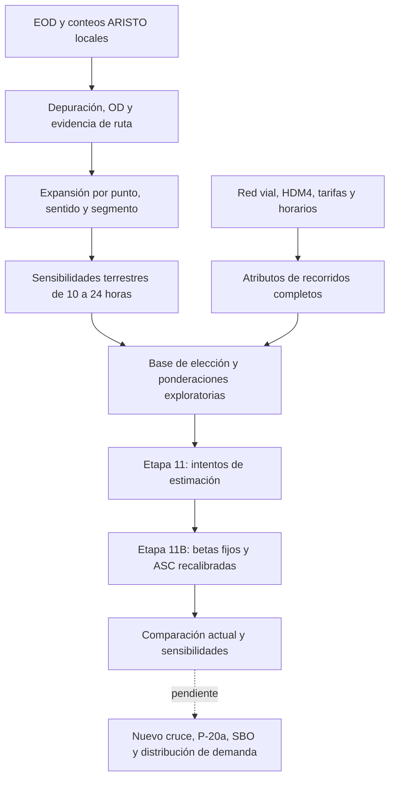

# Demanda de conectividad lacustre: Bahía Jara–Levicán

Repositorio del equipo **EVALSO**, proyecto *Conectividad Lacustre Lago General Carrera: Bahía Jara–Mallín Grande*, alternativa Bahía Jara–Levicán. Estudia viajes que podrían utilizar una conexión lacustre para reducir el recorrido alrededor del lago.

La referencia actual considera **terrestre por Chile (rutas265-CH y7)** y **barcaza Puerto Ibáñez–Chile Chico con sus accesos completos**. Argentina está excluida del modelo vigente. Puerto Ibáñez es una localidad: no equivale a toda la comuna Río Ibáñez.

**Estado vigente: Etapa 11B, calibración exploratoria con pendientes fijadas y ASC recalibradas.** No se ha calculado la demanda captada por el nuevo cruce, la variante P-20a, la comparación con SBO ni demanda inducida. Los resultados son preliminares, no una evaluación social terminada.

## Guía de lectura

1. [Resultados y limitaciones](docs/07_resultados_y_limitaciones.md): números e interpretación.
2. [Calibración logit](docs/05_calibracion_logit.md): ecuación, pesos y parámetros.
3. [Supuestos y sensibilidades](docs/06_supuestos_sensibilidades.md): qué se adopta y qué se observa.
4. [Próximos pasos](docs/08_proximos_pasos.md): nuevo cruce y acceso **P-20a**.
5. [Resultados compartibles](results/README.md): CSV para consultar sin Python.

## Metodología implementada

La referencia es el Informe 2 EVALSO. En el PDF local `INFORME_2_EVALSO-1.pdf`, la demanda está en §§3.2–3.3, ecuaciones3.2,3.3,3.8; la referencia previa a capítulo5 no coincide con esta versión.



ARISTO es fuente principal. CITRA aporta solamente informes PDF de contraste, sin microdatos disponibles y sin sumar sus muestras a ARISTO. Las auditorías de IA son índices, no fuentes primarias. [Detalle de fuentes](docs/01_fuentes_datos.md).

Se mantienen verano(dic–feb), otoño(mar–may), invierno(jun–ago), primavera(sep–nov). La frecuencia ordinaria del cruce es11 zarpes semanales por sentido diciembre–abril y8 mayo–noviembre, excluida carga peligrosa. Otoño conserva el cambio marzo/abril–mayo. No se imputa invierno silenciosamente.

## Resultados numéricos que pueden consultarse

### Ejemplo OD expandido: VL, Chile Chico → Coyhaique

Unidades: vehículos por jornada de 10 h o por día equivalente, según columna. **La cifra terrestre24 h es sensibilidad, no conteo observado**.

| estacion | origen | destino | ruta | flujo_10h_vehiculos | flujo_diario_equivalente_vehiculos | estado |
| --- | --- | --- | --- | --- | --- | --- |
| Verano | Chile Chico | Coyhaique | barcaza_actual | No publicado / faltante | 27.2381 | expandido_condicional |
| Verano | Chile Chico | Coyhaique | terrestre_chile | 23.179 | 38.2862 | sensibilidad_24h_NO_observado |

El resto de las matrices completas permanece local por celdas pequeñas, incertidumbre territorial y revisión complementaria de divulgación. `NaN` en `results/` puede significar reservado; nunca cero viajes. [Selección y alcance](results/README.md).

### Atributos del recorrido completo: Chile Chico → Coyhaique

Distancias km, tiempos h y COV privados CLP diciembre2025 por vehículo-viaje. Son trayectos entre anclajes públicos de la red, no domicilios ni centros urbanos validados. No incluyen aún todos los accesos intrazonales individuales.

| segmento | alternativa | distancia_terrestre_total_km | tiempo_conduccion_terrestre_h | tiempo_navegacion_h | COV_terrestre_privado_ARISTO_CLP |
| --- | --- | --- | --- | --- | --- |
| VL | terrestre_chile | 382.515 | 6.05203 | 0 | 78,538 |
| VL | barcaza_actual | 121.956 | 1.45839 | 2 | 22,135 |
| CAM | terrestre_chile | 382.515 | 7.23201 | 0 | 399,966 |
| CAM | barcaza_actual | 121.956 | 1.98438 | 2 | 97,372 |

La barcaza agrega tarifa vehicular de referencia21270CLP y pasajes según pagadores/exenciones; CAM sujeto a tarifa lineal7310CLP/m requiere longitud facturable. No son costos completos confirmados. El servicio de referencia Carolina publica6h para el viaje bimodal y el terrestre Interlagos8h: no se les vuelve a sumar navegación. [Construcción y faltantes](docs/04_atributos_alternativas.md).

### Modelo vigente: pendientes supuestas y constantes recalibradas

`V = ASC + beta_c C + beta_t t_viaje + beta_e t_horario + beta_a t_acceso`.

Para los tres segmentos: beta_c=−0,00002/CLP; beta_t=−0,20/h; beta_a=beta_e=−0,30/h; ASC_terrestre=0; lambda_lago=0,70. Son **supuestos de referencia**, no estimaciones locales ni valores numéricos acreditados por literatura para La Tehuelche. Wardman2004 y OECD/ITF2014 respaldan separar componentes, no este multiplicador específico.

| segmento | valor | metodo |
| --- | --- | --- |
| VL | -0.321915 | calibrado |
| CAM | -3.79334 | calibrado |
| PEATON | 0.0911272 | calibrado |

VL:61 entrevistas del soporte común con sensibilidad24 h. CAM:9 entrevistas de mayo, con tierra10 h frente ferry diario sin homologación. PEATON:3 celdas de cuota **proxy VL**, no3 encuestas ni una cuota observada de personas.

Cuotas globales reproducidas por calibración de ASC: VL 22,97%; CAM 48,78%(contraste temporal incompleto); PEATON 22,97%(proxy). La coincidencia global no es validación estadística independiente. El indicador de ajuste relativo a sola constante es aproximadamente0,039 para VL y−0,156 para CAM: las restricciones de CAM ajustan peor, aunque el optimizador converja. [Comparación con Etapa11](docs/07_resultados_y_limitaciones.md).

Ejemplos de probabilidad modelada de barcaza compartibles:

| origen | destino | estacion | segmento | probabilidad | estado_divulgacion |
| --- | --- | --- | --- | --- | --- |
| Chile Chico | Coyhaique | Verano | VL | 0.268862 | VL_soporte_compartido>=5_por_alternativa |
| Coyhaique | Chile Chico | Primavera | VL | 0.199454 | VL_soporte_compartido>=5_por_alternativa |
| Chile Chico | Coyhaique | Verano | PEATON | 0.273878 | perfil_modelado_con_cuota_proxy_NO_personas_observadas |
| Chile Chico | Coyhaique | Otoño | PEATON | 0.246053 | perfil_modelado_con_cuota_proxy_NO_personas_observadas |
| Chile Chico | Coyhaique | Invierno | PEATON | 0.19709 | perfil_modelado_con_cuota_proxy_NO_personas_observadas |
| Chile Chico | Coyhaique | Primavera | PEATON | 0.19709 | perfil_modelado_con_cuota_proxy_NO_personas_observadas |
| Coyhaique | Chile Chico | Verano | PEATON | 0.273878 | perfil_modelado_con_cuota_proxy_NO_personas_observadas |
| Coyhaique | Chile Chico | Otoño | PEATON | 0.246053 | perfil_modelado_con_cuota_proxy_NO_personas_observadas |
| Coyhaique | Chile Chico | Invierno | PEATON | 0.19709 | perfil_modelado_con_cuota_proxy_NO_personas_observadas |
| Coyhaique | Chile Chico | Primavera | PEATON | 0.19709 | perfil_modelado_con_cuota_proxy_NO_personas_observadas |

La probabilidad de tierra es1−P_barcaza. Las probabilidades CAM y otras celdas de soporte reducido no se divulgan por OD; están en salidas locales. Peatones es perfil de transporte público condicionado a proxy. No multiplicar estas probabilidades por una población desconocida ni interpretar invierno como demanda observada.

Sensibilidades11B: acceso/viaje1,0/1,5/2,0; horario/viaje0,5/1,0/1,5; VST5000/10000/15000CLP por unidad de decisión-h; lambda 0,5/0,7/0,9. Un factor a la vez; se recalibra ASC, salvo lambda, que no altera probabilidades actuales con un elemento por nido. El VST del VL es por vehículo, el del CAM por camión y el peatonal por persona: la igualdad inicial no demuestra equivalencia económica.

## Uso sin conocimientos previos de Python

Para leer los resultados basta abrir los Markdown y CSV de `results/`. En GitHub los CSV se muestran como tablas. **Los microdatos y originales no se distribuyen**; la base individual de calibración tampoco.

Entorno probado: Python 3.12.9, Biogeme 3.3.2; ver [versiones](docs/09_organizacion_y_publicacion.md). Desde una terminal dentro del repositorio:

```bash
python3 -m venv .venv
source .venv/bin/activate
python -m pip install -r requirements-dev.txt
PYTHONPATH=src python -m pytest -q
python scripts/13_validar_repositorio.py
```

Las pruebas usan datos sintéticos, nunca encuestas originales. Algunas comprueban Biogeme con datos sintéticos: no vuelven a estimar demanda real. Para matrices/red sin calibración basta `requirements.txt`; `requirements-logit.txt` incorpora Biogeme. Los pasos con PDF requieren `pdftotext` de Poppler instalado en el sistema.

### Reproducción completa autorizada con fuentes locales

El código espera los originales en la carpeta padre. Ejemplo de organización, sin copiar esos archivos a Git:

```text
Anexos/
├── Cap 6/BBDD EOD/Base de datos agregada.xlsx
├── Cap 6/Mediciones de flujo/Consolidado Flujos.xlsx
├── Cap 7/HDM4/ y SIG Red_Vial_Final/
├── Cap 8/ y Cap 10/
├── Estudios de consultoras/          # PDF CITRA
├── Informe ARISTO.pdf
├── INFORME_2_EVALSO-1.pdf
└── demanda-lago-general-carrera/     # este repositorio
```

Lista exacta: [fuentes](docs/01_fuentes_datos.md). Orden del flujo vigente:

```bash
python scripts/07_matrices_od_referencia.py
python scripts/08_expandir_tiempo_terrestre.py
python scripts/09_construir_atributos.py
python scripts/10_completar_atributos_logit.py
python scripts/11_calibrar_logit.py
python scripts/11b_recalibrar_logit.py
```

**Estos comandos vuelven a calcular resultados: se documentan para reproducción futura y no se ejecutaron durante la organización.** El script 03 se conserva porque07/10 importan sus lectores; no ejecutar su antiguo estimador porcentual. Las transcripciones CITRA reservadas son opcionales para contraste;07 usa una plantilla vacía si no están presentes. No cambia la expansión de ARISTO.

Para actualizar solamente las copias seleccionadas después de una reproducción local revisada:

```bash
python scripts/12_preparar_resultados_compartibles.py
python scripts/13_validar_repositorio.py
```

Sin originales ni `outputs/` privados se puede consultar resultados, validar los CSV compartidos, revisar fórmulas y ejecutar pruebas sintéticas. **No se puede recalibrar el modelo individual ni reproducir matrices completas desde el material publicado.** El script 12 requiere salidas locales ya calculadas; no es una fuente alternativa de datos.

## Estructura

```text
src/demanda/       Funciones reutilizables
scripts/           Etapas07–11B y herramientas de revisión; legado identificado
data/templates/   Configuraciones y esquemas sin microdatos
docs/             Fuentes, método, supuestos, resultados y próximos pasos
results/          Selección vigente compartible, CSV y Markdown
archive/          Documentación inicial y comparación histórica Etapa11
outputs/          Resultados detallados locales, excluidos deGit
data/interim/     Cachés locales, excluidos deGit
```

[Catálogo de código y dependencias](docs/09_organizacion_y_publicacion.md). Se conservaron los históricos importantes; no se borraron cálculos ni se movieron scripts que son dependencias.

## Estado y continuación

Terminado de forma exploratoria: matrices de referencia, escenarios10→24 h, rutas/atributos actuales, intentos11 y recalibración11B. Pendiente: nuevo cruce completo con **P-20a**, SBO diferenciada de operación histórica, aplicación jerárquica con dos cruces, distribución de demanda, inducción separada y anualización sustentada. [Plan del equipo](docs/08_proximos_pasos.md).

## Privacidad y publicación

Se publica código, método y una selección de resultados derivados. No originales Excel/PDF/SIG, domicilios, coordenadas individuales, identificadores, tickets, elecciones individuales, bases de consultoras, cachés ni credenciales. Las celdas reducidas y algunas complementarias se reservan; no interpretar su ausencia como ausencia de viajes. No se otorga licencia de redistribución sobre datos de terceros.

Remoto existente: https://github.com/Natalyuxias/demanda-lago-general-carrera — rama `main`. La disponibilidad remota de esta actualización depende del resultado del push; [estado de publicación](docs/09_organizacion_y_publicacion.md).
